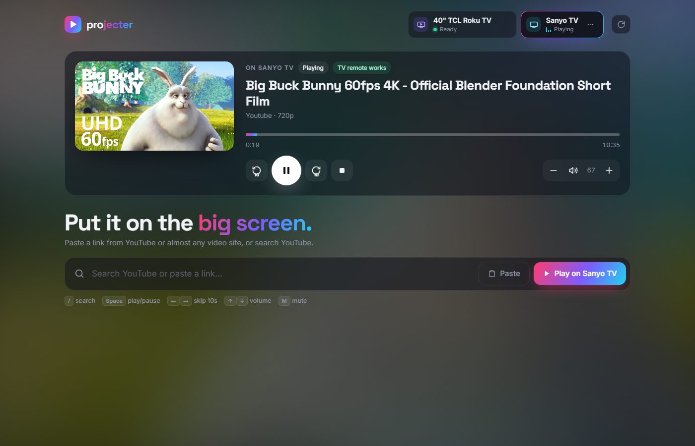
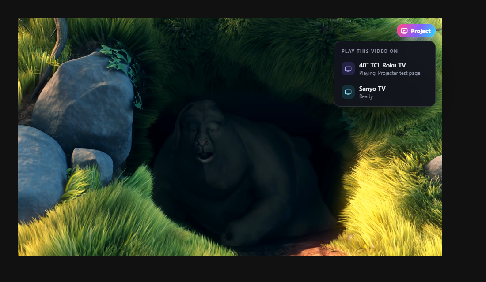
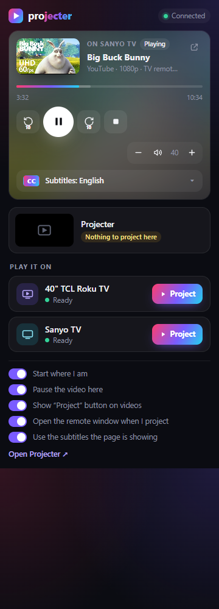
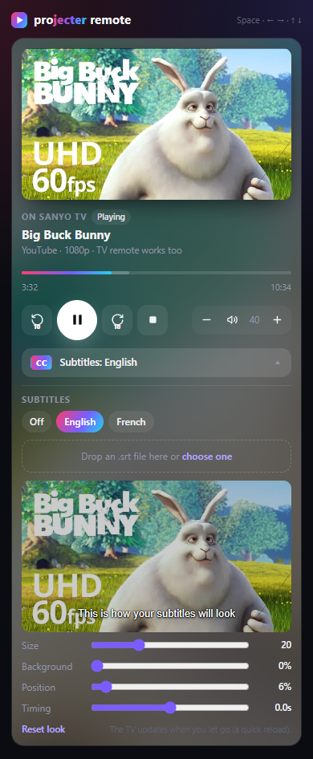
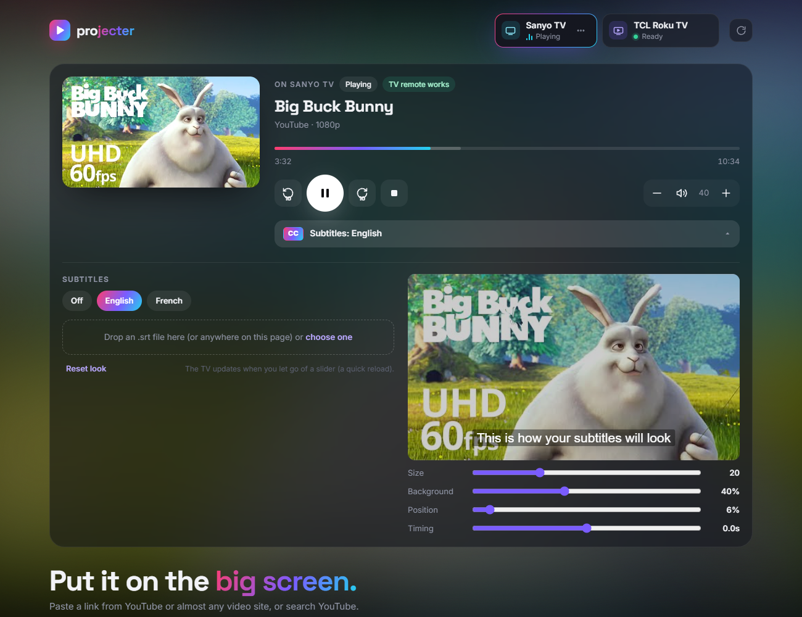

# Projecter

**Put any video from your laptop on your TV — YouTube, website players, live streams — with real remote-control-style controls, subtitles, and a one-click browser extension.**

Projecter is a small app that runs on your Windows laptop and streams video to the TVs on your Wi-Fi: DLNA smart TVs (tested on a Sanyo) and Roku TVs (tested on a TCL Roku TV). It comes with a web app for searching and controlling playback, and a Brave/Chrome extension that adds a **▶ Project** button to every video player on the web.



---

## Contents

- [Features](#features)
- [How it works](#how-it-works)
- [Requirements](#requirements)
- [Installation](#installation)
- [The browser extension](#the-browser-extension)
- [Using Projecter](#using-projecter)
- [Subtitles](#subtitles)
- [TV setup notes](#tv-setup-notes)
- [Troubleshooting](#troubleshooting)
- [Project layout](#project-layout)
- [Limitations](#limitations)
- [Privacy & security](#privacy--security)

---

## Features

**Casting**
- Finds your TVs automatically and shows which are **Ready, in Standby, Offline or Playing**. Pick one, or play different things on several TVs at once.
- Paste a link from YouTube or **almost any video site**, paste a direct `.m3u8` / `.mpd` / `.mp4` stream, or search YouTube right in the app.
- Picks the best quality up to **1080p H.264** (what TVs decode reliably), including separate audio tracks in multi-quality streams.
- Works with **live streams** — and live streams can be **paused and resumed** (Projecter records while you're paused, so you pick up where you left off).
- Wakes a Roku TV from standby when you cast to it.

**Controls that actually work**
- Play / pause, skip ±10 s, drag-to-seek, stop, and TV volume — from the web app, the extension popup, or a pop-out remote window.
- Skips are fast: video is cached on the laptop, so jumping around doesn't re-download anything.
- **Your normal TV remote works too.** The TV is given a properly seekable stream, so its own pause / skip buttons (and the Roku remote) keep working.
- Keyboard shortcuts: `Space` play/pause · `←` `→` skip 10 s · `↑` `↓` volume · `M` mute · `/` search.

**Browser extension (Brave / Chrome / Edge)**
- A **▶ Project** button appears when you hover any video on any website — even inside embedded players and in fullscreen.
- Toolbar popup with the video found on the page, your TVs, and a full remote for what's playing.
- Right-click → **Project to TV**.
- Detects the actual stream the page's player loads (HLS, DASH, MP4), with the cookies and headers it needs.
- Starts the TV **at the same moment** you were watching, and pauses the video in the browser.
- Starts Projecter in the background automatically if it isn't running.

**Subtitles**
- Picks up the subtitles the website's player is showing (and lists the other tracks it finds).
- Drop your own `.srt` / `.vtt` file onto the remote or the web app.
- Sliders for **size, background opacity, position and timing**, with a live preview.

---

## How it works

```
 ┌──────────────── your laptop ─────────────────┐            ┌────── your TVs ──────┐
 │                                               │            │                      │
 │  Brave + extension ──┐                        │            │  DLNA TV (e.g. Sanyo)│
 │  (finds the stream)  │      Projecter app     │   Wi-Fi    │   ← seekable MPEG-TS │
 │                      ├──▶  • yt-dlp           │ ─────────▶ │                      │
 │  Web app ────────────┘     • ffmpeg repackage │            │  Roku TV             │
 │  (http://localhost:8765)   • local cache      │            │   ← HLS via Media    │
 │                            • TV control       │            │     Assistant        │
 └───────────────────────────────────────────────┘            └──────────────────────┘
```

1. **Finding the video.** For sites [yt-dlp](https://github.com/yt-dlp/yt-dlp) supports (YouTube, Vimeo, Twitch and hundreds more), Projecter asks yt-dlp for the best stream. For other sites, the browser extension hands over the stream the page's own player is loading, plus the cookies/headers needed to open it. As a last resort, Projecter scans the page for a video link.
2. **Downloading fast.** YouTube throttles long single downloads to roughly real-time speed, so Projecter fetches in 4 MB chunks with prefetching — a 10-minute 1080p video is typically cached in 5–10 seconds.
3. **Repackaging.** ffmpeg remuxes the video into MPEG-TS (no re-encoding, so it's quick and lossless) and writes an HLS index alongside it. Everything after that is served from the laptop's disk, which is why skipping is quick.
4. **Sending it to the TV.**
   - **DLNA TVs** get the file over HTTP with byte-range support and its size announced up front. That makes the TV treat it as a normal seekable file, which is what unlocks the TV's own **pause and seek** (many DLNA TVs refuse to pause a plain stream). Playback starts immediately while the rest is still downloading.
   - **Roku TVs** get the same video as HLS, played by the free *Media Assistant* channel. Roku's own player then handles the remote. Optionally, YouTube links can open in Roku's YouTube app instead.
5. **Control.** Projecter talks to the TVs over UPnP/DLNA (AVTransport, RenderingControl) and Roku's External Control Protocol, and keeps the web app and extension in sync.

---

## Requirements

- **Windows 10/11** (the app is Python and mostly portable; the background launcher for the extension is Windows-specific).
- **Python 3.10+**
- **ffmpeg** and **ffprobe** on your `PATH` — e.g. `winget install Gyan.FFmpeg`
- **Node.js** — yt-dlp uses it to solve YouTube's JavaScript challenges; without it only low qualities are offered. `winget install OpenJS.NodeJS`
- **yt-dlp** (installed from `requirements.txt`)
- A TV on the **same Wi-Fi network**: a DLNA/UPnP media renderer, or a Roku TV.

---

## Installation

```bash
git clone https://github.com/fhusster/projecter.git
cd projecter
pip install -r requirements.txt
```

Start it:

```bash
python projecter.py
```

…or double-click **`Projecter.bat`**. Your browser opens **http://localhost:8765**.

> **First run:** Windows will ask whether to allow Python on the network. Click **Allow** (tick *Private* and, if your home Wi-Fi is set to *Public*, also *Public*). The TVs need to reach the laptop to fetch the video.

Options: `--no-browser` (don't open a tab), `--debug` (log TV requests and timing).

---

## The browser extension



### Install (Brave, Chrome or Edge)

1. Open `brave://extensions` (or `chrome://extensions` / `edge://extensions`).
2. Turn on **Developer mode**.
3. Click **Load unpacked** and choose the **`extension`** folder.
4. Pin **Projecter** from the puzzle-piece menu.
5. Optional but recommended — let the extension start Projecter by itself:

   ```bash
   python install_extension.py
   ```

   This registers a tiny native-messaging helper (`native/projecter_host.py`) with Brave, Chrome and Edge for your user account. Undo it any time with `python install_extension.py --uninstall`.

After updating the files, press the reload button (↻) on the extension's card.

### Using it

| | |
|---|---|
| **▶ Project button** | Hover any video → click **Project** → pick a TV. |
| **Toolbar popup** | Shows the detected video, your TVs, and a full remote for what's playing. The ↗ button pops the remote out into its own window. |
| **Right-click** | **Project to TV → *your TV***. On a link, it sends the linked page. |
| **Remote window** | A small window that stays open next to the browser. Opens automatically when you project (can be turned off). |

Popup settings: *Start where I am* · *Pause the video here* · *Show “Project” button on videos* · *Open the remote window when I project* · *Use the subtitles the page is showing*.

<p>
  
  &nbsp;&nbsp;
  
</p>

---

## Using Projecter

- **Pick a TV** from the pills at the top (status: Ready / Standby / Offline / Playing). The ⋯ menu lets you rename a TV, and for Rokus choose whether YouTube opens in **Roku's YouTube app**.
- **Play something:** paste a link and press **Play**, use the **Paste** button, or type a search and click a result.
- **Control it:** the now-playing card has the progress bar (the lighter part shows how much is cached), skip, play/pause, stop and volume.
- **Several TVs:** select another TV and cast — each TV keeps playing its own thing.

---

## Subtitles



### Instant subtitle changes on Roku (Projecter channel)

Normally subtitles are drawn into the picture, so each change restarts the video on the TV.
On a Roku you can install Projecter's own channel (the `roku/` folder) instead: the Roku then
draws the subtitles itself, and track, size, background, position and timing change instantly
while the video keeps playing.

Setup takes a few minutes (Roku Developer Mode + one command). See
**[ROKU_SETUP.md](ROKU_SETUP.md)** for step-by-step instructions. Projecter uses the channel
automatically once it's installed.

Open the **Subtitles** bar under the controls (web app, popup, or remote window):

- **Tracks** — *Off*, the subtitles found on the page, and any you've added.
- **Your own file** — drop an `.srt` / `.vtt` (or `.ass`) onto the remote window or anywhere on the web app, or click *choose one*.
- **Look & timing** — **Size**, **Background** opacity, **Position** (bottom → top) and **Timing** (−15 s … +15 s). The preview updates as you drag; the TV updates when you let go (a quick reload from where you are). Your look is remembered.

Where page subtitles come from:
- `<track>` files on the video element, and tracks the player adds itself (including its "add subtitles" feature) — the one it's **showing** is used.
- Subtitle files the page downloads (`.vtt`, `.srt`, `.ass`, or by content type) — players that draw subtitles themselves only download the one you picked.
- Subtitle tracks listed in the HLS stream, and subtitles yt-dlp knows about.

How they get on screen: DLNA TVs and Roku's player can't load a separate subtitle file sent this way, so Projecter **draws the subtitles into the picture** with ffmpeg/libass. That needs re-encoding, so subtitled videos play at **720p** (about 5× faster than real time on a typical laptop). Encoding starts from where you're watching, so switching subtitles on halfway through a movie is near-instant.

---

## TV setup notes

### DLNA TVs (Sanyo and others)
Nothing to set up — the TV just needs to be on and on the same network. Projecter finds it via SSDP. (Sanyo TVs report themselves as an "AwoX Media Renderer"; Projecter names them *Sanyo TV*, and you can rename them.)

### Roku TVs
1. **Allow network control:** *Settings → System → Advanced system settings → Control by mobile apps → Network access → **Enabled***. (Roku's default *Limited* mode blocks most commands.)
2. **Add the free *Media Assistant* channel:** *Home → Streaming Store → search “Media Assistant” → Add channel.* Roku removed its built-in “play this URL” feature for outside apps; Media Assistant is the standard replacement.

Projecter shows a reminder on the Roku's card if either of these is missing.

For **instant subtitle changes**, install Projecter's own Roku channel instead of (or alongside) Media Assistant: see **[ROKU_SETUP.md](ROKU_SETUP.md)**.

---

## Troubleshooting

| Problem | Fix |
|---|---|
| **No TVs found** | Make sure the TV is on and on the same Wi-Fi, then press the refresh button. Check that Windows Firewall allows Python. |
| **TV shows nothing / “can't play”** | Almost always the firewall blocking the TV from reaching the laptop. Allow Python on the network (see Installation). |
| **Roku: “blocking network control”** | Set *Control by mobile apps → Network access* to **Enabled**. |
| **Roku: plays YouTube but not other sites** | Add the *Media Assistant* channel. |
| **YouTube suddenly stops working** | YouTube changes often — run `pip install -U yt-dlp`. |
| **A site's video won't play** | Some sites protect their video with DRM (Netflix, Disney+, Prime Video…); those can't be sent to a TV. Otherwise, start the video in the browser first so the extension can see its stream, then project. |
| **Extension says it can't start Projecter** | Run `python install_extension.py`, or start Projecter yourself with `Projecter.bat`. |
| **The extension didn't change after an update** | Press reload (↻) on its card in `brave://extensions`. |
| **Low quality on YouTube** | Install Node.js (yt-dlp needs it for the higher qualities). |

Logs: run `python projecter.py --debug` to see what the TVs request. When started in the background by the extension, Projecter writes to `projecter.log`.

---

## Project layout

```
projecter/
├── projecter.py            # the app: TV discovery & control, streaming, web UI, API
├── Projecter.bat           # double-click launcher (Windows)
├── requirements.txt
├── install_extension.py    # registers the extension's background launcher
├── install_roku_channel.py # installs Projecter's Roku channel (see ROKU_SETUP.md)
├── ROKU_SETUP.md           # Roku setup guide
├── native/
│   ├── projecter_host.py   # native-messaging helper that starts Projecter
│   └── extension_id.txt    # the extension's fixed ID (from the public key in manifest.json)
├── extension/              # Brave / Chrome / Edge extension (Manifest V3)
│   ├── manifest.json
│   ├── background.js       # stream & subtitle detection, casting, right-click menu
│   ├── content.js          # the ▶ Project button on video players
│   ├── popup.html/.js/.css # toolbar popup
│   ├── remote.html/.js/.css, remote-window.js   # shared remote + pop-out window
│   └── icons/
├── roku/                   # Projecter's Roku channel (draws subtitles live)
│   ├── manifest
│   ├── source/main.brs
│   └── components/         # MainScene (video + subtitles), CuesTask
└── docs/screenshots/
```

**Local API** (used by the web app and the extension; `http://localhost:8765`)

| Endpoint | |
|---|---|
| `GET /api/state?device=<id>` | TVs and what the selected one is playing |
| `GET /api/search?q=<text>` | YouTube search |
| `POST /api/cast` | `{device, url, start?, candidates?, subtitles?, sub_style?}` |
| `POST /api/control` | `{device, action, value?}` — `play`, `pause`, `toggle`, `seek`, `stop`, `vol_up`, `vol_down`, `mute`, `subs`, `subs_add`, `subs_style` |
| `POST /api/device` | rename a TV, choose the Roku YouTube-app option, select a TV |
| `POST /api/scan` | look for TVs again |

---

## Limitations

- **DRM-protected video** (Netflix, Disney+, Prime Video, etc.) can't be cast.
- **Subtitles** are drawn into the picture, so subtitled playback is 720p and changing them is a short reload rather than instant. They're not available for live streams or Roku's YouTube app.
- **Subtitles a player draws itself from a file you loaded from your computer** aren't visible to the extension — drop that `.srt` into Projecter instead.
- In **Roku's YouTube app** mode, skipping is done with the Roku remote (the app can't be told to seek).
- The laptop needs to stay on while a video plays.
- Some DLNA TVs take a few seconds to confirm a command; the controls update immediately anyway.

---

## Privacy & security

- Everything runs on your own laptop and network. There are no accounts, no tracking, and no external servers other than the video sites themselves.
- Only the Projecter web page and the Projecter extension may control your TVs: requests coming from any other website are rejected, so a page you visit can't take over your TV.
- The extension reads the stream URLs, cookies and headers of the video you choose to project, and sends them only to Projecter on `localhost`.
